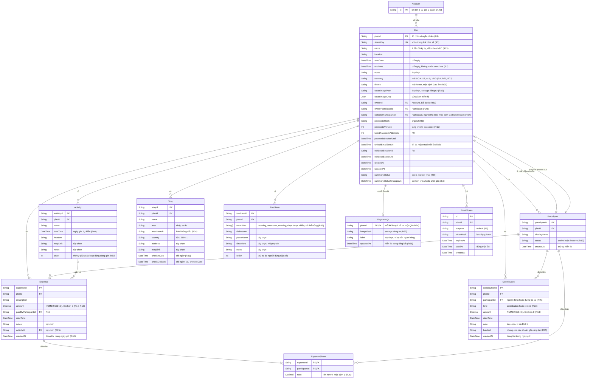

# Data model — Kế hoạch, chi phí, lịch trình

Các bảng của module [01](../requirements/01-ke-hoach-va-quyen-truy-cap.md), [02](../requirements/02-nguoi-tham-gia-va-chi-phi.md) và [03](../requirements/03-lich-trinh-noi-o-mon-an.md). Quy tắc xóa và ràng buộc: [README](README.md).

