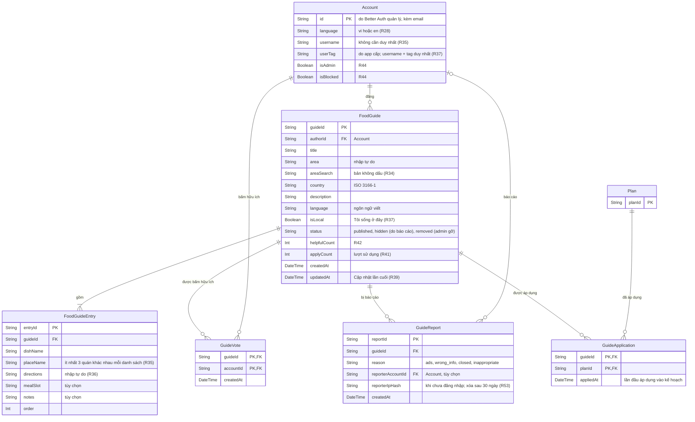

# Data model — Tài khoản và Gợi ý quán ăn

Các bảng của module [04](../requirements/04-goi-y-quan-an.md), cùng các cột app thêm vào tài khoản. Plan chỉ hiện khóa chính; đủ cột ở [01-ke-hoach.md](01-ke-hoach.md). Món áp dụng vào kế hoạch là bản sao độc lập nên FoodItem không liên kết tới FoodGuide (R41). Quy tắc xóa và ràng buộc: [README](README.md).

