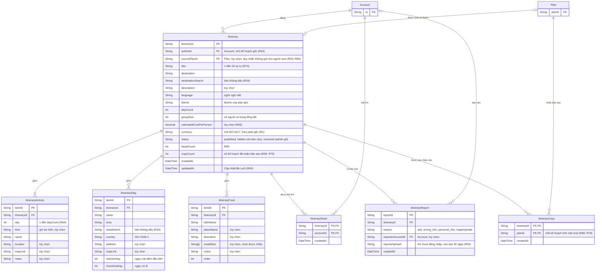

# Data model — Chia sẻ hành trình

Các bảng của module [07](../requirements/07-chia-se-hanh-trinh.md). Account và Plan chỉ hiện khóa chính; đủ cột ở [02-goi-y-quan-an.md](02-goi-y-quan-an.md) và [01-ke-hoach.md](01-ke-hoach.md). Hành trình là bản sao độc lập của kế hoạch, nên các mục của nó không liên kết tới Activity, Stay hay FoodItem; kế hoạch nhận bản sao cũng không liên kết ngược lại, ngoài bảng ItineraryCopy dùng để đếm lượt sao chép (R66, R68, R79). Quy tắc xóa và ràng buộc: [README](README.md).

