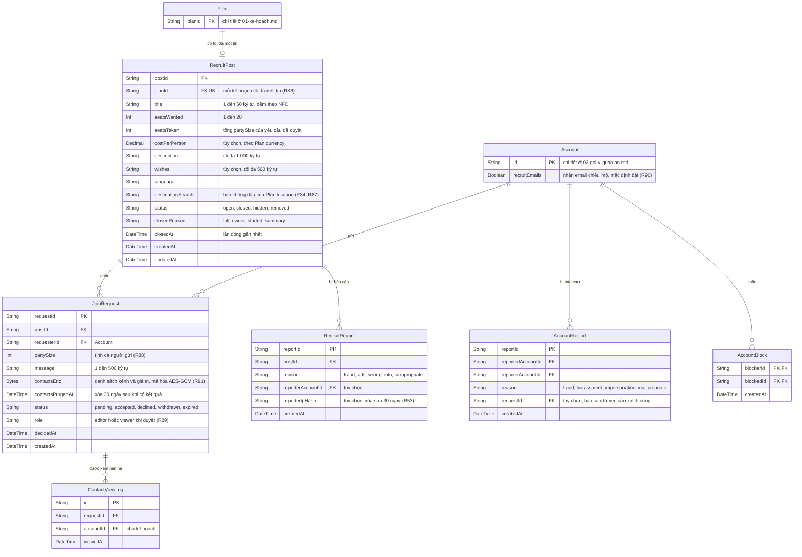

# Data model — Chiêu mộ bạn đồng hành

Các bảng của module [08](../requirements/08-chieu-mo.md). Plan và Account chỉ hiện khóa chính; đủ cột ở [01-ke-hoach.md](01-ke-hoach.md) và [02-goi-y-quan-an.md](02-goi-y-quan-an.md). Quy tắc xóa và ràng buộc: [README](README.md).

Điểm đến, ngày đi, ngày về, số người trong nhóm và lịch trình của tin đọc trực tiếp từ Plan, Participant và Activity, không lưu lại trong RecruitPost (R86). Người được duyệt có thêm một dòng PlanMember với `joinedVia = request` ([01-ke-hoach.md](01-ke-hoach.md)).
