# Data model (ERD)

Vẽ từ phần Dữ liệu của các module [requirements](../requirements/README.md). Tên bảng và cột viết theo kiểu Prisma để dùng thẳng khi viết schema; tên mang tính khái niệm và có thể đổi khi triển khai.

Sơ đồ chi tiết (đủ cột):

- [01-ke-hoach.md](01-ke-hoach.md): kế hoạch, thành viên, người tham gia, chi phí, QR, lịch trình, nơi ở, món ăn, email token
- [02-goi-y-quan-an.md](02-goi-y-quan-an.md): tài khoản, trang người dùng, danh sách gợi ý, tim, báo cáo, lượt áp dụng
- [03-hanh-trinh.md](03-hanh-trinh.md): hành trình chia sẻ, các mục của hành trình, tim, báo cáo
- [04-chieu-mo.md](04-chieu-mo.md): tin chiêu mộ, yêu cầu xin đi cùng, log xem liên hệ, báo cáo tin và người dùng, chặn

Sơ đồ dùng Mermaid: GitHub hiển thị sẵn; trong VS Code cần extension hỗ trợ Mermaid cho Markdown preview.

## Tổng quan quan hệ

```mermaid
erDiagram
  Account ||--o{ Plan : "sở hữu"
  Account ||--o{ PlanMember : "là thành viên"
  Plan ||--|{ PlanMember : "có"
  PlanMember |o--|| Participant : "gắn với"
  Plan ||--o{ PlanInvite : "có link mời"
  Plan ||--o{ Participant : "có"
  Participant ||--o| Plan : "là chủ kế hoạch của"
  Plan ||--o{ Activity : "có"
  Plan ||--o{ Stay : "có"
  Plan ||--o{ FoodItem : "có"
  Plan ||--o{ Expense : "có"
  Plan ||--o| PaymentQr : "có tối đa một"
  Plan ||--o{ EmailToken : "có"
  Plan ||--o{ Contribution : "có"
  Participant ||--o{ Contribution : "đóng tiền"
  Participant ||--o| Plan : "là người thu tiền của"
  Participant ||--o{ Expense : "trả tiền"
  Expense ||--|{ ExpenseShare : "chia cho"
  Participant ||--o{ ExpenseShare : "chịu phần"
  Activity |o--o{ Expense : "gắn với"
  Account ||--o{ FoodGuide : "đăng"
  FoodGuide ||--|{ FoodGuideEntry : "gồm"
  FoodGuide ||--o{ GuideHeart : "được thả tim"
  Account ||--o{ GuideHeart : "thả tim"
  FoodGuide ||--o{ GuideReport : "bị báo cáo"
  Account |o--o{ GuideReport : "báo cáo"
  FoodGuide ||--o{ GuideApplication : "được áp dụng"
  Plan ||--o{ GuideApplication : "đã áp dụng"
  Account ||--o{ Itinerary : "đăng"
  Plan |o--o| Itinerary : "được chia sẻ thành"
  Itinerary ||--|{ ItineraryActivity : "gồm"
  Itinerary ||--o{ ItineraryStay : "gồm"
  Itinerary ||--o{ ItineraryFood : "gồm"
  Itinerary ||--o{ ItineraryHeart : "được thả tim"
  Itinerary ||--o{ ItineraryReport : "bị báo cáo"
  Itinerary ||--o{ ItineraryCopy : "được sao chép vào"
  Plan ||--o{ ItineraryCopy : "nhận bản sao"
  Plan ||--o| RecruitPost : "có tối đa một tin"
  RecruitPost ||--o{ JoinRequest : "nhận"
  Account ||--o{ JoinRequest : "gửi"
  RecruitPost ||--o{ RecruitReport : "bị báo cáo"
  Account ||--o{ AccountReport : "bị báo cáo"
  Account ||--o{ AccountBlock : "chặn"
```

## Các bảng

| Bảng | Module | Ghi chú |
|---|---|---|
| Plan | [01](../requirements/01-ke-hoach-va-quyen-truy-cap.md) | Gồm cả passcode lock, edit lock, ảnh nền, theme |
| Account | [01](../requirements/01-ke-hoach-va-quyen-truy-cap.md) | Đăng nhập bằng Google, hoặc email hay username kèm mật khẩu, do Better Auth quản lý (plugin username; kể cả xác nhận email, đặt lại mật khẩu); app thêm các cột riêng (R61, R78) |
| PlanMember, PlanInvite | [01](../requirements/01-ke-hoach-va-quyen-truy-cap.md) | Thành viên là tài khoản có quyền Chủ, Sửa hoặc Xem, gắn với một người tham gia (R84); PlanInvite là link mời một người tham gia dùng tài khoản (R85). Người được duyệt yêu cầu xin đi cùng có `joinedVia = request` ([08](../requirements/08-chieu-mo.md)) |
| EmailToken | [01](../requirements/01-ke-hoach-va-quyen-truy-cap.md) | Token của link mở khóa nhập passcode, gửi đến email của chủ kế hoạch (R9) |
| Participant, Contribution | [02](../requirements/02-nguoi-tham-gia-va-chi-phi.md) | Contribution ghi tiền đóng và tiền trả lại của từng người (R75) |
| Expense, ExpenseShare | [02](../requirements/02-nguoi-tham-gia-va-chi-phi.md) | Mỗi dòng ExpenseShare là một người chia và tỷ lệ |
| PaymentQr | [02](../requirements/02-nguoi-tham-gia-va-chi-phi.md) | Khóa chính là `planId`, nên mỗi kế hoạch tối đa một QR |
| Activity, Stay, FoodItem | [03](../requirements/03-lich-trinh-noi-o-mon-an.md) | |
| FoodGuide, FoodGuideEntry, GuideHeart, GuideReport, GuideApplication | [04](../requirements/04-goi-y-quan-an.md) | GuideApplication ghi kế hoạch nào đã áp dụng danh sách nào |
| Itinerary, ItineraryActivity, ItineraryStay, ItineraryFood, ItineraryHeart, ItineraryReport, ItineraryCopy | [07](../requirements/07-chia-se-hanh-trinh.md) | Bản sao độc lập của kế hoạch đã chốt; ngày thật đổi thành số thứ tự ngày; ItineraryCopy ghi kế hoạch nào đã nhận bản sao |
| RecruitPost, JoinRequest, ContactViewLog, RecruitReport, AccountReport, AccountBlock | [08](../requirements/08-chieu-mo.md) | Tin chiêu mộ đọc điểm đến, ngày, số người và lịch trình trực tiếp từ kế hoạch; thông tin liên hệ mã hóa, xóa sau 30 ngày |

## Khác với phần Dữ liệu trong requirements

- `editPasscode` → `passcodeHash` (argon2) và `passcodeVersion`; đổi passcode thì tăng version để vô hiệu phiên edit cũ (R11).
- `passcodeLock` → `failedPasscodeAttempts`, `passcodeLockedUntil`, `unlockEmailSentAt` (R9).
- `editLock` → `editLockSessionId`, `editLockExpiresAt` (R8).
- `coverImage` → `coverImagePath` và `coverImageCrop` (R30).
- `shares` → bảng ExpenseShare.
- `hasLeftParticipantWarning` không lưu, tính từ trạng thái của người chia (R21).
- Thêm `areaSearch` (bản không dấu của khu vực) cho Stay, FoodGuide và ItineraryStay, và `destinationSearch` cho Itinerary (R34).
- `token` của link mời → `tokenHash`; PlanInvite thêm `usedByAccountId` và `revokedAt`. PlanMember thêm `joinedVia`.
- Thêm bảng EmailToken và GuideApplication; thêm `createdAt` cho Participant để giữ thứ tự hiển thị.

## Quy tắc xóa

- Xóa Plan thì xóa toàn bộ dữ liệu con: PlanMember, PlanInvite, RecruitPost (cùng JoinRequest, ContactViewLog, RecruitReport), Participant, Contribution, Expense, ExpenseShare, Activity, Stay, FoodItem, PaymentQr, EmailToken, GuideApplication, ItineraryCopy. Ảnh nền và ảnh QR trong storage cũng bị xóa (R22, R24, R30, R57).
- Xóa Participant: nếu có trong Expense, ExpenseShare, Contribution hoặc là `Plan.collectorParticipantId` thì chỉ đổi `status = inactive`; nếu không thì xóa hẳn, không hỏi xác nhận. Participant là `Plan.ownerParticipantId` không xóa được (R13, R26).
- Xóa Participant (xóa hẳn hoặc chuyển `inactive`) thì xóa PlanMember gắn với nó và hủy PlanInvite chưa dùng của nó; thành viên rời hoặc bị gỡ thì chỉ xóa PlanMember, giữ Participant (R84).
- Xóa Expense thì xóa các ExpenseShare của nó.
- Xóa Activity thì xóa các Expense gắn với nó, kèm ExpenseShare của chúng (R58).
- Khi `Plan.summaryStatus` là `locked` hoặc `final`, server từ chối mọi thao tác thêm, sửa, xóa Participant, Activity, Expense, ExpenseShare. Contribution vẫn thêm, sửa, xóa được (R23). `locked` đổi về `open` được; `final` không đổi được nữa (R59).
- FoodItem áp dụng từ danh sách gợi ý là bản sao độc lập, không có khóa ngoại tới FoodGuide (R41).
- Tác giả gỡ FoodGuide thì xóa hẳn cùng FoodGuideEntry, GuideHeart, GuideReport, GuideApplication; admin gỡ thì chỉ đổi `status = removed` (R39, R44).
- Xóa Plan hoặc FoodItem không làm giảm `FoodGuide.applyCount` (R41).
- Xóa Plan không xóa Itinerary được chia sẻ từ nó, chỉ đặt `Itinerary.sourcePlanId` trống (R66).
- Tác giả gỡ Itinerary thì xóa hẳn cùng ItineraryActivity, ItineraryStay, ItineraryFood, ItineraryHeart, ItineraryReport, ItineraryCopy; admin gỡ thì chỉ đổi `status = removed` (R66, R69).
- Xóa Plan đã nhận bản sao từ hành trình không làm giảm `Itinerary.copyCount` (R68, R79).
- `GuideReport.reporterIpHash`, `ItineraryReport.reporterIpHash` và `RecruitReport.reporterIpHash` bị xóa (đặt trống) sau 30 ngày (R53).
- `JoinRequest.contactsEnc` bị xóa (đặt trống, ghi `contactsPurgedAt`) 30 ngày sau `decidedAt`; yêu cầu `pending` của tin vừa đóng chuyển sang `expired` (R90, R91).

## Ràng buộc và index

- Plan: `shareKey` duy nhất; `ownerId` bắt buộc; `startDate <= endDate <= startDate + 59 ngày` (R2); danh sách kế hoạch lấy qua PlanMember theo `accountId`, sắp theo `startDate`, chia mục theo `summaryStatus` (R60–R62).
- PlanMember: khóa chính `(planId, accountId)`; `participantId` duy nhất; đúng một dòng `owner` mỗi kế hoạch, khớp `Plan.ownerId`; index `(accountId)` cho danh sách kế hoạch (R62, R84).
- PlanInvite: `tokenHash` duy nhất; mỗi người tham gia tối đa một link còn hiệu lực (`usedAt` và `revokedAt` trống, chưa hết hạn) (R85).
- RecruitPost: `planId` duy nhất; `seatsTaken <= seatsWanted`; index `(status)` kết hợp `Plan.startDate`, và index trigram trên `destinationSearch` (R86, R87).
- JoinRequest: duy nhất theo `(postId, requesterId)` (R88); gửi lại sau khi hết hạn thì cập nhật dòng cũ về `pending`; index `(postId, status)` cho màn duyệt và `(requesterId, status)` cho bộ lọc Đã gửi.
- AccountBlock: khóa chính `(blockerId, blockedId)`; RecruitReport duy nhất theo `(postId, reporterAccountId)` và `(postId, reporterIpHash)` (R92).
- Expense: index `(planId, dateTime)`; Activity: index `(planId, date, time)`; để hiển thị theo thời gian và lọc theo ngày (R60, R81).
- FoodItem: index `(planId, order)` để hiển thị theo thứ tự; lọc theo buổi trên mảng `mealSlots` (R33).
- Account: `username` duy nhất, lưu chữ thường (R78); `userTag` duy nhất (R37).
- ExpenseShare: khóa chính `(expenseId, participantId)`; `ratio > 0` (R16).
- Expense: `amount > 0`, kiểu `NUMERIC(14,3)`; với tiền tệ không có phần lẻ, `amount` của Expense và Contribution là số nguyên, kiểm tra ở `src/domain` (R14, R18).
- Plan và Itinerary: `currency` là mã có trong danh sách tiền tệ của ứng dụng, kiểm tra ở server; `Plan.currency` chỉ đổi được khi kế hoạch chưa có Expense, Contribution và `summaryStatus = open` (R1, R72).
- Stay: `checkOutDate > checkInDate` (R31); việc không chồng ngày kiểm tra ở `src/domain`.
- GuideHeart: khóa chính `(guideId, accountId)` (R42).
- Account: `userTag` và `publicId` duy nhất; `publicId` sinh ngẫu nhiên, không suy ra được mã tài khoản (R37, R83).
- GuideReport: duy nhất theo `(guideId, reporterAccountId)` và `(guideId, reporterIpHash)` (R43).
- GuideApplication: khóa chính `(guideId, planId)`, nên mỗi kế hoạch chỉ tính một lượt sử dụng (R41).
- Stay và FoodGuide: index trigram trên `areaSearch` (R34); FoodGuide thêm index `(status, areaSearch)`.
- Itinerary: `sourcePlanId` duy nhất khi có giá trị, nên mỗi kế hoạch tối đa một hành trình (R63); index `(status, destinationSearch)` và index trigram trên `destinationSearch`; ItineraryStay có index trigram trên `areaSearch` (R34, R67).
- ItineraryActivity: `day` từ 1 đến `Itinerary.dayCount`; ItineraryStay: `checkOutDay > checkInDay` (R64).
- ItineraryHeart: khóa chính `(itineraryId, accountId)`; ItineraryReport: duy nhất theo `(itineraryId, reporterAccountId)` và `(itineraryId, reporterIpHash)` (R69).
- ItineraryCopy: khóa chính `(itineraryId, planId)`, nên mỗi kế hoạch chỉ tính một lượt sao chép (R68, R79).
- Contribution: `amount > 0`; index `(planId, dateTime)` để hiển thị theo thời gian (R60, R75).
- Plan: `collectorParticipantId` là người tham gia của chính kế hoạch đó; đổi người thu tiền thì xóa PaymentQr (R54).
- Mọi khóa chính trừ `planId` là UUID hoặc cuid, không tự tăng (R49).

## Không lưu trong database

- Lựa chọn "Bạn là ai?" và ngôn ngữ khi chưa đăng nhập: lưu trên thiết bị (R27, R28).
- Phiên edit: cookie httpOnly có ký, gắn với `planId` và `passcodeVersion`.
- Bộ đếm rate limit: Upstash Redis (R47).
- Danh sách theme và hình minh họa: nằm trong code; Plan chỉ lưu mã theme (R29).
- Danh sách tiền tệ (mã, tên tiếng Việt và tiếng Anh, ký hiệu, số chữ số lẻ, bước làm tròn, các nước dùng, nhóm phổ biến): nằm trong code, sinh từ dữ liệu ISO 4217 và CLDR; Plan và Itinerary chỉ lưu mã (R1, R19, R71).
