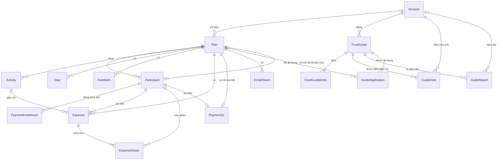

# Data model (ERD)

Vẽ từ phần Dữ liệu của các module [requirements](../requirements/README.md). Tên bảng và cột viết theo kiểu Prisma để dùng thẳng khi viết schema; tên mang tính khái niệm và có thể đổi khi triển khai.

Sơ đồ chi tiết (đủ cột):

- [01-ke-hoach.md](01-ke-hoach.md): kế hoạch, người tham gia, chi phí, QR, lịch trình, nơi ở, món ăn, email token
- [02-goi-y-quan-an.md](02-goi-y-quan-an.md): tài khoản, danh sách gợi ý, hữu ích, báo cáo, lượt áp dụng

Sơ đồ dùng Mermaid: GitHub hiển thị sẵn; trong VS Code cần extension hỗ trợ Mermaid cho Markdown preview.

## Tổng quan quan hệ

## Các bảng

| Bảng | Module | Ghi chú |
|---|---|---|
| Plan | [01](../requirements/01-ke-hoach-va-quyen-truy-cap.md) | Gồm cả passcode lock, edit lock, ảnh nền, theme |
| Account | [01](../requirements/01-ke-hoach-va-quyen-truy-cap.md) | Thông tin đăng nhập do Better Auth quản lý; app thêm các cột riêng |
| EmailToken | [01](../requirements/01-ke-hoach-va-quyen-truy-cap.md) | Token xác nhận email, mở khóa, đổi passcode |
| Participant, PaymentInstallment | [02](../requirements/02-nguoi-tham-gia-va-chi-phi.md) | |
| Expense, ExpenseShare | [02](../requirements/02-nguoi-tham-gia-va-chi-phi.md) | Mỗi dòng ExpenseShare là một người chia và tỷ lệ |
| PaymentQr | [02](../requirements/02-nguoi-tham-gia-va-chi-phi.md) | Khóa chính là `planId`, nên mỗi kế hoạch tối đa một QR |
| Activity, Stay, FoodItem | [03](../requirements/03-lich-trinh-noi-o-mon-an.md) | |
| FoodGuide, FoodGuideEntry, GuideVote, GuideReport, GuideApplication | [04](../requirements/04-goi-y-quan-an.md) | GuideApplication ghi kế hoạch nào đã áp dụng danh sách nào |

## Khác với phần Dữ liệu trong requirements

- `editPasscode` → `passcodeHash` (argon2) và `passcodeVersion`; đổi passcode thì tăng version để vô hiệu phiên edit cũ (R11).
- `passcodeLock` → `failedPasscodeAttempts`, `passcodeLockedUntil`, `unlockEmailSentAt` (R9).
- `editLock` → `editLockSessionId`, `editLockExpiresAt` (R8).
- `recoveryEmail` có thêm `recoveryEmailVerifiedAt` (R10).
- `coverImage` → `coverImagePath` và `coverImageCrop` (R30).
- `paymentInstallments` → bảng PaymentInstallment; `shares` → bảng ExpenseShare.
- `hasLeftParticipantWarning` không lưu, tính từ trạng thái của người chia (R21).
- Thêm `areaSearch` (bản không dấu của khu vực) cho Stay và FoodGuide (R34).
- Thêm bảng EmailToken và GuideApplication; thêm `createdAt` cho Participant để giữ thứ tự hiển thị.

## Quy tắc xóa

- Xóa Plan (hoặc hết hạn) thì xóa toàn bộ dữ liệu con: Participant, PaymentInstallment, Expense, ExpenseShare, Activity, Stay, FoodItem, PaymentQr, EmailToken, GuideApplication. Ảnh nền và ảnh QR trong storage cũng bị xóa (R22, R24, R30, R57).
- Xóa Participant: nếu có trong Expense, ExpenseShare hoặc là `collectorParticipantId` của PaymentQr thì chỉ đổi `status = inactive`; nếu không thì xóa hẳn, không hỏi xác nhận. Participant là `Plan.ownerParticipantId` không xóa được (R13, R26).
- Xóa Expense thì xóa các ExpenseShare của nó.
- Xóa Activity thì xóa các Expense gắn với nó, kèm ExpenseShare của chúng (R58).
- Khi `Plan.summaryStatus` là `locked` hoặc `final`, server từ chối mọi thao tác thêm, sửa, xóa Participant, Activity, Expense, ExpenseShare. `locked` đổi về `open` được; `final` không đổi được nữa (R59).
- FoodItem áp dụng từ danh sách gợi ý là bản sao độc lập, không có khóa ngoại tới FoodGuide (R41).
- Tác giả gỡ FoodGuide thì xóa hẳn cùng FoodGuideEntry, GuideVote, GuideReport, GuideApplication; admin gỡ thì chỉ đổi `status = removed` (R39, R44).
- Xóa Plan hoặc FoodItem không làm giảm `FoodGuide.applyCount` (R41).
- `GuideReport.reporterIpHash` bị xóa (đặt trống) sau 30 ngày (R53).

## Ràng buộc và index

- Plan: `shareKey` duy nhất; index `(ownerType, updatedAt)` cho job xóa sau 30 ngày; index `(ownerId, startDate)` cho danh sách kế hoạch (R60).
- Expense và Activity: index `(planId, dateTime)` để hiển thị theo thời gian và lọc theo ngày (R60).
- FoodItem: index `(planId, date, mealSlot)` để sắp xếp và lọc theo ngày, buổi (R33).
- Account: `(username, userTag)` duy nhất (R37).
- ExpenseShare: khóa chính `(expenseId, participantId)`; `ratio > 0` (R16).
- Expense: `amount > 0`, kiểu `NUMERIC(14,3)` (R14, R18).
- Stay: `checkOutDate > checkInDate` (R31); việc không chồng ngày kiểm tra ở `src/domain`.
- GuideVote: khóa chính `(guideId, accountId)` (R42).
- GuideReport: duy nhất theo `(guideId, reporterAccountId)` và `(guideId, reporterIpHash)` (R43).
- GuideApplication: khóa chính `(guideId, planId)`, nên mỗi kế hoạch chỉ tính một lượt sử dụng (R41).
- Stay và FoodGuide: index trigram trên `areaSearch` (R34); FoodGuide thêm index `(status, areaSearch)`.
- Mọi khóa chính trừ `planId` là UUID hoặc cuid, không tự tăng (R49).

## Không lưu trong database

- Lựa chọn "Bạn là ai?" và ngôn ngữ khi chưa đăng nhập: lưu trên thiết bị (R27, R28).
- Phiên edit: cookie httpOnly có ký, gắn với `planId` và `passcodeVersion`.
- Bộ đếm rate limit: Upstash Redis (R47).
- Danh sách theme và hình minh họa: nằm trong code; Plan chỉ lưu mã theme (R29).
